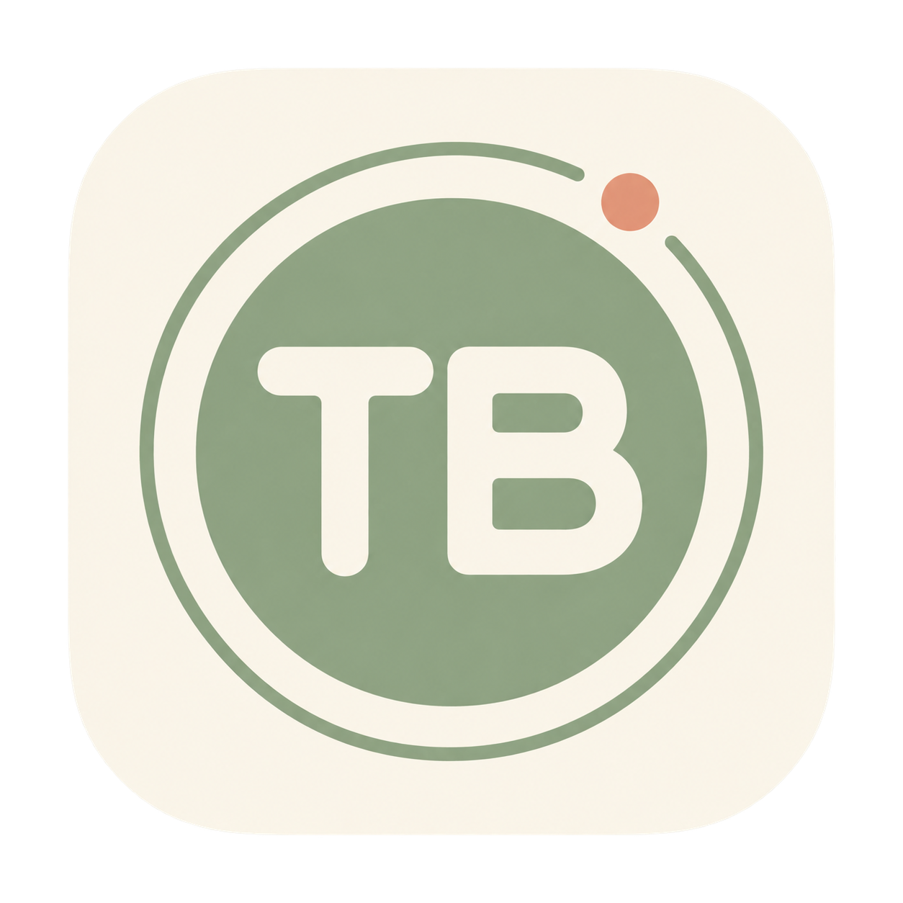

# ThumbBall 1.6

使用一只 Logitech MX ERGO，在原生 macOS 鼠标操作与中英文打字之间切换。

[下载最新 App](https://github.com/narsecho/ThumbBall/releases/latest) · [验证说明](VERIFICATION.md)

## 项目目的

ThumbBall 源于 FSD 出行场景下的单手电脑交互设想：希望一只手握住轨迹球鼠标，就能完成指针操作、搜索、文字回复和短文本输入，减少鼠标与键盘之间的切换。车内实际使用限安全停车或乘客状态，驾驶员不应在行驶中操作电脑，FSD 不能作为分心使用电脑的依据。项目同样适用于桌面办公、移动办公及单手电脑操作需求。

原生 Swift / AppKit / CGEventTap，适配 Apple Silicon。使用 Xcode Command Line Tools 构建，不依赖完整 Xcode。新版内置 Rime 1.17.0 和雾凇基础/扩展中文词库，离线解析九宫格拼音，无需安装鼠须管输入法。

## 启动与切换

默认 Mouse Mode。左右键一起按住2秒进入打字模式，再次双键保持2秒或按实体 Esc 恢复鼠标。2秒从第二个键按下起计算；可以先按左键再按右键，避免明显拖动。帮助窗口“开启打字”是备用入口。

滚轮左右倾斜切换已启用的系统键盘输入源：系统处于美式键盘等 ASCII 输入源时显示英文布局，处于简体拼音等非 ASCII 输入源时显示内置中文九键布局。请先在 macOS 键盘设置启用 U.S. 与简体拼音。系统拼音用于标识中英文模式；九键中文解析、候选和组词由 ThumbBall 内置 Rime 完成，不会把数字编码发送给系统拼音。

左右倾斜兼容横向滚动事件及按钮5/6，防抖400ms。Mouse Mode 保留原横向滚动行为。驱动若拦截倾斜，须保留原始横向滚动；若使用 Options+，请检查其自定义设置是否拦截原始鼠标事件。

## 标准九宫格布局

280×224点小浮层，不抢焦点、不接收鼠标点击。中文与英文使用相同的标准九宫格位置：

|左上|上|右上|
|---|---|---|
|符号|ABC|DEF|
|GHI|JKL（中心）|MNO|
|PQRS|TUV|WXYZ|

轨迹球方向与格子位置对应：上选ABC，右上DEF，左GHI，右MNO，左下PQRS，下TUV，右下WXYZ。选中心JKL时，先移动再返回中心区域停顿；静止不自动输入。默认停顿220ms提交，提交后虚拟位置重置，需再次移动达到阈值。英文每格上方保留字母组提示，下方显示当前页的字母。

### 英文

滚轮上下翻页，字母组位置始终不变，不按常用频率排序，也不展开选字。

|固定方向字母组|第1页|第2页|第3页|第4页|
|---|---|---|---|---|
|ABC|a|b|c|空|
|DEF|d|e|f|空|
|GHI|g|h|i|空|
|JKL|j|k|l|空|
|MNO|m|n|o|空|
|PQRS|p|q|r|s|
|TUV|t|u|v|空|
|WXYZ|w|x|y|z|

输入后保留当前页。第4页后继续翻至数字/标点、编程符号、编辑键页。空位不输出。左上“符号”跳到数字/符号页；数字/符号页左上“字母”返回字母页。中心格对应JKL当前页的字母，不再作为空格。

左键空格，右键退格（删除光标前一个字符），滚轮按下回车。左右双键短按不输入；长按2秒切换模式。

保留内置小型英文完整单词联想：仅根据 ThumbBall 输入前缀预测，不读取文档或剪贴板。有候选时末尾增加联想词页，从第一页上滚可到达；选中词发送剩余后缀及空格。词库有限，代码、人名等可逐字输入。

完整26字母的第一层自动按上述固定组分页，旧版频率布局不再使用；自定义其他层仍保留。若第一层不是完整26字母，按自定义内容分页。

### 中文九宫格

八个字母格（含中心JKL）始终显示八组字母，每选一组向内置引擎输入相应的2–9编码。无需确定组内具体字母，也不需要翻字母页。例如“你好”：MNO→GHI→GHI→ABC→MNO，即64426（nihao）。

下方显示组合编码和最多三个中文候选，高亮候选用【】标记。默认首选词；滚轮上下逐个选择，跨越本页边界时切换下一页/上一页候选。左键提交当前候选，不额外加空格。右键优先删除尚未提交的拼音编码，组合为空时才向目标应用发退格。滚轮按下先确认当前候选再发送回车。

没有待输入拼音时，左键输入空格；左上“符号”进入数字、标点和编程符号页。此时滚轮上下翻页，左上“拼音”返回九键。编码无候选时，左上“清空”取消该组合，或用右键逐个修正；不会把无效数字直接发进文档。

本版支持基础T9全拼候选和组句，尚未实现手机输入法那样的音节筛选侧栏、云词库或下一词预测。候选准确率依赖本地词库；不保证与微信输入法相同。引擎会在本机学习已选中文词，用户词库只存于 ThumbBall 专用目录。

切换前台应用、实体键盘输入、中英文切换、退出或恢复鼠标会取消未提交组合，避免把旧组合带入新位置。回车会真的向目标应用发送 Return，请在空白文本中测试。

## 构建与安装

在 Finder 双击 build.command，或终端执行 `./build.command`。`./build.command --no-install` 仅构建。产物 ThumbBall.app / ThumbBall.zip，默认安装到 `~/Applications/ThumbBall.app`。更新前退出旧版。

构建包含：校验随项目附带的官方 arm64 librime、编译C桥接和Swift、在临时目录预编译词库、打包全部运行资源、逐个签名动态库及App、执行纯布局测试和真实Rime测试、严格验证签名。重复构建不需要联网、Homebrew或完整Xcode。Rime引擎使用官方预编译发布库；本脚本不从C++源代码重编该库。版本、来源及SHA256见 Resources/Licenses/THIRD-PARTY.txt。

辅助功能中启用安装副本。启动帮助应显示中文引擎就绪、启动自检通过、辅助功能true、监听true。本地 ad-hoc 签名更新可能使旧授权失效，需在系统设置→隐私与安全性→辅助功能中移除旧条目，再添加 `~/Applications/ThumbBall.app`。无Developer ID或公证，不绕过系统权限。

构建在 `/private/tmp` 签名，避开 Documents/iCloud FinderInfo 属性。双击已运行的App会重新显示帮助。菜单提供恢复鼠标、退出、权限引导、映射和日志入口。

## 配置、日志与安全

`~/Library/Application Support/ThumbBall/mapping.json`：菜单“编辑字符映射”，修改后“重新加载映射”。保留旧文件，不删除配置。`gestureThreshold` 8–500（默认32），`idleMilliseconds` 100–1500（默认220）。旧 sideButtons / holdMilliseconds 字段只兼容读取，不控制固定左右键2秒激活。

数字/符号层每8项一页，依次放在ABC、DEF、GHI、JKL、MNO、PQRS、TUV、WXYZ对应的标准格子。左上保留为返回字母/拼音；完整保留原始数字及符号条目。特殊项：`␣ Space`、`⌫ Backspace`、`↵ Enter`、`⇥ Tab`。普通字符串以Unicode提交。

`~/Library/Application Support/ThumbBall/Rime`：内置引擎用户词库；不与其他Rime应用目录混用。日志 test.log 最近500条，不记录输入正文；引擎仅保留错误级诊断。词库本身会保存学习的词，这与不记录按键正文的测试日志不同。

默认鼠标模式；休眠、权限丢失、tap失效和退出恢复鼠标。鼠标事件为所有鼠标/触控板合并，不能只针对MX ERGO。打字模式抑制指针移动。双键激活会缓冲鼠标模式的左右键，在释放时重放；累计拖动超过约12单位则重放并透传拖动。单键长按控件可能延迟，这是现有激活手势的折衷。

## 验证

`ThumbBall.app/Contents/MacOS/ThumbBall --self-test`：四页固定组、26字母唯一覆盖、方向、JSON和映射有效性。

`ThumbBall.app/Contents/MacOS/ThumbBall --rime-self-test`：实际加载Rime和完整随包词库，在临时用户目录检查“你好”“中国”“输入”、候选确认、退格、候选翻页、清空、无效编码；并验证新九宫格轨迹球方向→T9→中文确认的控制器路径，包括中心JKL。测试捕获输出，不向其他App发送按键。

启动AppKit事件测试验证2秒激活、common模式计时器、鼠标配对/拖动、字符选择、左右中键、滚轮、故障恢复。命令行 `--integration-test` 使用临时目录且不启动事件监听；AppKit在受限命令行环境可能无法启动，以桌面启动显示结果为准。软件测试不替代真实目标应用验收。

## 开源来源

librime：BSD-3-Clause，https://github.com/rime/librime 。雾凇词库与改编T9配置：GPL-3.0，https://github.com/iDvel/rime-ice 。所需许可、来源说明与词库原始注释均保留；项目源代码随包提供。图标为奶油白、鼠尾草绿和杏色的TB简约图标。
